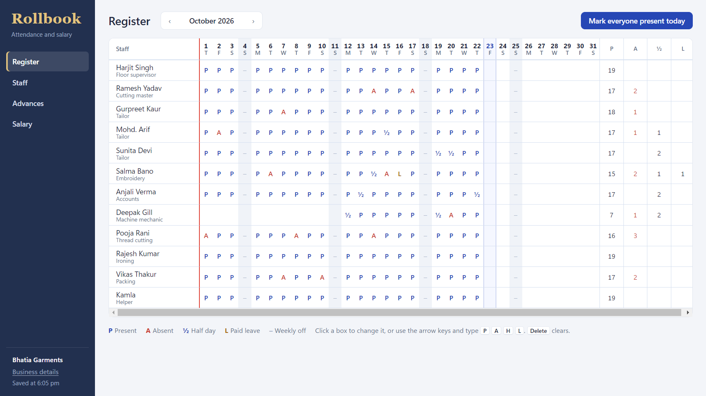
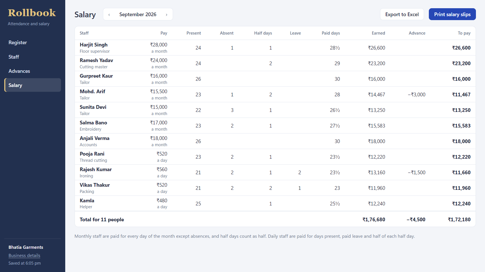
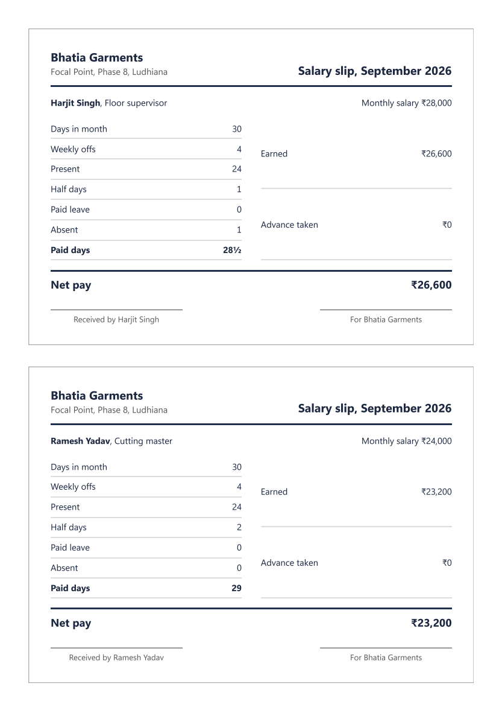

# Rollbook

Attendance register and salary for small businesses, as a Windows desktop app.

Many workshops, shops and clinics still keep attendance in a paper register and work out salaries by hand at the end of the month. One wrong count means a dispute with someone who has worked for you for years. Rollbook keeps the register on screen and does the salary sum the same way every time.



## What it does

- **Register.** One row per person and one box per day, laid out like the paper register it replaces. Click a box, or move with the arrow keys and type P, A, H or L. A single button marks everyone present for today.
- **Staff.** Monthly salary or daily wage, weekly off day, joining date and phone. People who leave stay in past registers and salary sheets.
- **Advances.** Money given during the month is taken off that month's salary.
- **Salary.** Present, absent, half days, paid leave, paid days, earnings, advances and the amount to pay for each person. Days nobody marked are flagged before you pay.
- **Excel export** with live formulas, so totals still add up if the sheet is edited.
- **Salary slips** as a PDF, two to an A4 page, ready to print and sign.
- **Your data stays on your computer.** It is saved after every change, and the previous copy is kept as a backup.



## How salary is worked out

- **Monthly salary:** salary × (days employed − absent days − half of the half days) ÷ days in the month. Weekly offs and paid leave are paid.
- **Daily wage:** wage × (days present + paid leave + half of the half days).
- Someone who joins mid-month is paid from their joining date.
- Advances given in a month are deducted from that month's pay.



## Install

Download `Rollbook-Setup-1.0.0.exe` from [Releases](../../releases) and run it. Windows 10 or 11, 64-bit.

The installer is not code-signed yet, so Windows SmartScreen may warn the first time. Choose **More info**, then **Run anyway**.

The app opens with a sample business, Bhatia Garments, so you can try every screen straight away. The business and the people in it are fictional.

## Run from source

```
npm install
npm start
npm test
```

## About

Designed and built by Akash Sharma. © 2026 Akash Sharma. All rights reserved.
